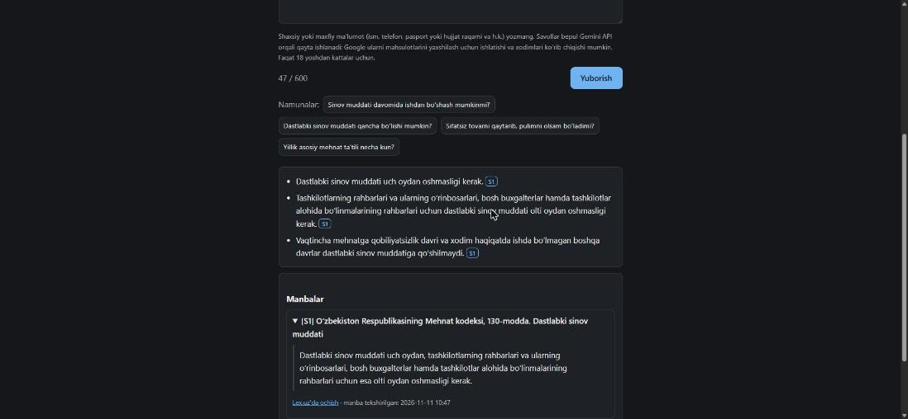
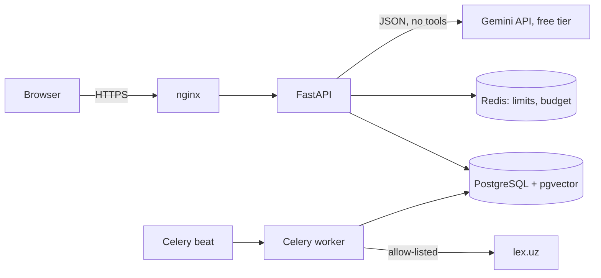

# LexUZ RAG

Source-grounded answers to legal questions in Uzbek, built on official texts
from [Lex.uz](https://lex.uz). A user asks one question; the system finds the
relevant articles and answers in Uzbek (Latin) with citations that link to the
exact article on Lex.uz.

> **Free-tier service:** answers use the Gemini API free tier. When the free
> quota is used up, answering is temporarily unavailable (“Bepul AI kvotasi
> hozircha tugagan…”); the document list keeps working. Questions are sent to
> Google and, on the free tier, may be used to improve Google products and be
> read by human reviewers — do not enter personal or confidential data.
> Not yet allowed for users in the EEA, Switzerland or the UK (free-tier terms).

> **Not an official Lex.uz product** and not affiliated with the Ministry of
> Justice of Uzbekistan. It explains sources; it is not legal advice.

## Status (2026-11-11)

| Area | State |
|---|---|
| Corpus | ✅ Labor Code (593 articles) and Consumer Protection Law (33 articles), Uzbek Latin. Consumer law: live fetch. Labor Code: local import of the official page (live fetch hit a DNS failure), later **confirmed identical by a live fetch**. |
| Ingestion | ✅ fetch → snapshot → parse → publish gate → chunk → embed → atomic activation; idempotent; CLI + Celery |
| Retrieval | ✅ hybrid (pgvector + PostgreSQL FTS + article-number match, weighted RRF); evaluated on real data |
| Answer generation | ✅ **verified with the real Gemini API (free tier)** on 2026-11-11: model `gemini-3.5-flash-lite` (`gemini-3.8-flash` was visible to the key but timed out, D20); `google-genai` SDK, structured JSON, no tools; citation/quote validation, repair, fallback; quota/safety/timeout handling; provider safety blocks reported as `provider_blocked`. ⚠️ Answer faithfulness not yet human-reviewed. |
| Rate limit / budget | ✅ Redis Lua, tested with real Redis incl. 20-thread race and Redis outage |
| Frontend | ✅ single static page, Uzbek UI, text-only rendering, XSS test |
| Tests / CI | ✅ unit + PostgreSQL/pgvector + Redis integration tests, frontend XSS, offline Gemini adapter tests (no real API in CI). ✅ GitHub Actions CI green — live status [](https://github.com/xojiakbarasomoff/lexuz-rag/actions/workflows/ci.yml) · last verified run (Gemini live eval commit be3f165, 91 tests, Docker build): https://github.com/xojiakbarasomoff/lexuz-rag/actions/runs/43021674203 |
| Eval | ✅ 50-item benchmark (AI-drafted, **not human-verified** — review sheet + form in `evals/review/` with model answers, citations and verdict fields; 16 items flagged to check first; all 50 `not_reviewed`). ✅ retrieval dev/holdout, ✅ live answer eval on dev (RRF k=10 baseline) and ✅ one-time holdout answer eval — all **preliminary** until human review |
| Deployment / CD | ⚠️ configs and scripts ready and locally validated; CD workflow runs after CI and currently skips with a notice (no `DEPLOY_HOST`). **Not deployed** — no VPS, domain or secrets |
| Live URL | none yet |
| Demo video | not recorded |

## Screenshot

Real local UI (dark mode), 2026-11-11: the question “Dastlabki sinov muddati
qancha bo‘lishi mumkin?” answered by `gemini-3.5-flash-lite` (free tier); every
claim cites S1 = Labor Code art. 130, the source card shows the stored original
text and the Lex.uz link. The privacy notice is above the submit button.



## Architecture



Details: [docs/architecture.md](docs/architecture.md) ·
[data provenance](docs/data-provenance.md) ·
[retrieval & citations](docs/retrieval-and-citations.md) ·
[evaluation](docs/evaluation.md) · [deployment](docs/deployment.md) ·
[operations](docs/operations.md) · [decisions](docs/decisions.md) ·
[demo script](docs/demo-script.md) · [learning plan](docs/learning-plan.md)

## Local setup

Requirements: Docker, [uv](https://docs.astral.sh/uv/), Python 3.12.

```bash
cp .env.example .env            # set POSTGRES_PASSWORD, DATABASE_URL, (optional) GEMINI_API_KEY
docker compose up -d postgres redis
uv sync --extra local-embeddings
uv run alembic upgrade head
uv run python -m app.cli ingest istemolchilar-huquqlari   # minutes; downloads the ~2.2 GB embedding model once
uv run python -m app.cli ingest mehnat-kodeksi            # ~40 min on a laptop CPU (816 chunks)
uv run uvicorn app.api.main:app --port 8000               # http://localhost:8000
```

Everything in Docker: `docker compose up -d --build`, then
`docker compose exec api alembic upgrade head` and
`docker compose exec worker python -m app.cli ingest all`.

Without `GEMINI_API_KEY` the catalog, retrieval eval and UI work; `/ask`
returns `provider_auth` (“AI xizmati sozlanmagan”).

## Ingestion

```bash
uv run python -m app.cli sources                 # approved sources
uv run python -m app.cli ingest all              # check + update
uv run python -m app.cli status                  # versions, jobs, last check
uv run python -m app.cli approve-version <id>    # after manual review of a held version
```

There is no HTTP endpoint for ingestion and no way to fetch an arbitrary URL.

## Ask API

```bash
curl -s localhost:8000/api/v1/ask -H 'Content-Type: application/json' \
  -d '{"question": "Sinov muddati davomida ishdan bo‘shash mumkinmi?"}'
```

Response shape (example structure, not a recorded answer):

```json
{
  "request_id": "…",
  "status": "answered",
  "claims": [{"text": "…", "source_ids": ["S1"]}],
  "sources": [{"source_id": "S1", "document_title": "Oʻzbekiston Respublikasining Mehnat kodeksi",
               "article_label": "132", "article_title": "Dastlabki sinov natijasi",
               "excerpt": "…verbatim text from the stored article…",
               "source_url": "https://lex.uz/docs/-6257288#-<element id>",
               "version_id": "…", "checked_at": "2026-11-11T05:47:55Z"}],
  "clarifying_question": null,
  "limitations": [],
  "corpus_checked_at": "2026-11-11T05:01:53Z",
  "latency_ms": 0
}
```

`status` is `answered`, `insufficient_evidence` or `clarification_needed`.
Errors: `{"request_id", "error": {"code", "message"}}` with codes such as
`rate_limited`, `budget_exhausted`, `generation_unavailable`,
`provider_timeout`. OpenAPI: `/api/docs`, `/api/openapi.json`.
`checked_at` is when this index last verified the source — not an effective date.

## Evaluation results (real runs, retrieval only)

`fastembed:intfloat/multilingual-e5-large`, top-k 6, weighted RRF (semantic 1.0 / FTS 0.25 / article number 2.0). Dev row uses RRF k=10 (D22); the holdout row is the earlier one-time run with k=60 — holdout was not re-run after the change:

| Split | n | Recall@1 | Recall@3 | Recall@6 | MRR |
|---|---|---|---|---|---|
| dev (tuned on), RRF k=10 | 26 of 30 | 0.712 | 0.827 | 0.904 | 0.796 |
| holdout (run once) | 17 of 20 | 0.706 | 0.882 | 1.000 | 0.801 |

Ambiguous and out-of-corpus items have no expected article and are excluded from Recall/MRR (they are scored by the answer eval). Small samples — one item ≈ 4–6 points.

### Answer eval — dev, real Gemini API (`gemini-3.5-flash-lite`, free tier, 2026-11-11)

After the retrieval fix (RRF k 60 → 10, D22), same 30 dev questions:

| Status accuracy | Abstain/clarify | Citation precision | Citation recall | Claim coverage | Provider blocks | p50 / p95 latency | Tokens in / out |
|---|---|---|---|---|---|---|---|
| 0.933 (28/30) | 1.0 (4/4) | 0.906 | 0.846 | 1.0 | 0 | 8.2 s / 18.5 s | 140,242 / 15,450 |

**Status accuracy** = the returned status (`answered` / `insufficient_evidence` /
`clarification_needed`) matched the expected one. It is **not** answer
accuracy and not legal correctness. Compared with the k=60 run, citation
precision went **down** (0.932 → 0.906) and latency went **up** (p50 3.8 s → 8.2 s).
Before the fix: status accuracy 0.867, precision 0.932, recall 0.788, p50 3.8 s.
4 items first failed with transient Gemini 5xx and were re-run once. $0
charged (free tier). Remaining failures and regressions are listed in
[docs/evaluation.md](docs/evaluation.md). Citation validity is not legal
correctness; semantic faithfulness has **not** been reviewed by a human, and
holdout answers were not run — the project is not "done".

### Answer eval — holdout, one-time run (PRELIMINARY: holdout not human-reviewed)

Frozen baseline `801e957` (RRF k=10, reranker off, prompt `answer-v1`,
`gemini-3.5-flash-lite` free tier), 20 holdout items, run once:

| Status accuracy | Abstain/clarify | Citation precision | Citation recall | Validation errors | Transient provider errors | p50 / p95 latency | Tokens in / out |
|---|---|---|---|---|---|---|---|
| 0.900 (18/20) | 1.0 (3/3) | 0.900 | 0.824 | 3 (2 non-verbatim quotes) | 2 (hold-10, unresolved) | 4.7 s / 14.3 s | 84,125 / 8,077 |

Status accuracy is a status match, not answer or legal accuracy. Nothing was
changed after this run; issues are in the future-work list in
[docs/evaluation.md](docs/evaluation.md). Further tuning needs new dev questions.

## Tests

```bash
docker compose up -d postgres redis
uv run pytest -q          # unit + integration (real PostgreSQL/pgvector and Redis)
uv run ruff check . && uv run ruff format --check .
```

Tests never call Lex.uz or an AI provider (fixtures + fake LLM). Parser
fixtures are trimmed real pages; see `tests/fixtures/PROVENANCE.md`.

## Deployment

Single Ubuntu VPS with Docker Compose, nginx + Let's Encrypt, CI-gated CD over
SSH with backup → migrate → smoke check → app rollback. Step-by-step:
[docs/deployment.md](docs/deployment.md). Not deployed yet.

## Limits and privacy

- Two documents only; no individual legal advice, no court-outcome
  prediction, no document drafting, single-turn questions only.
- A valid citation proves the quoted words exist in the cited article; it
  does not prove the answer interprets them correctly.
- Amendments that enter into force in the future block automatic activation
  until a human reviews them.
- Question text is not logged; IPs are hashed for rate limiting. On the
  Gemini free tier Google may use prompts/responses to improve its products
  and human reviewers may read them (Gemini API Additional Terms) — the UI
  asks users not to enter personal data; 18+ only.
- Free-tier quota limits (set in AI Studio, reset daily at midnight Pacific)
  can make answering temporarily unavailable; there is no paid fallback.
- Public demo limits: per-IP 3/min and 20/day, one concurrent LLM call,
  project-wide 5 calls/min and 200/day, 600-char questions, 2048 output
  tokens (incl. thinking), daily paid-equivalent budget; generation
  closes if Redis is unavailable. Cost figures are estimates.

## License of the data

Legal texts belong to their official publisher (Lex.uz / the Ministry of
Justice). This repository stores only small test excerpts with provenance;
the full corpus is fetched at run time.
