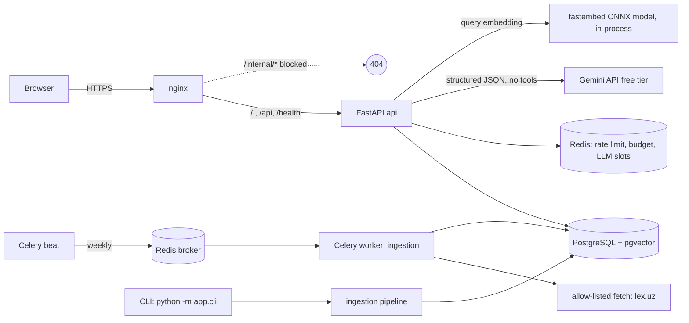
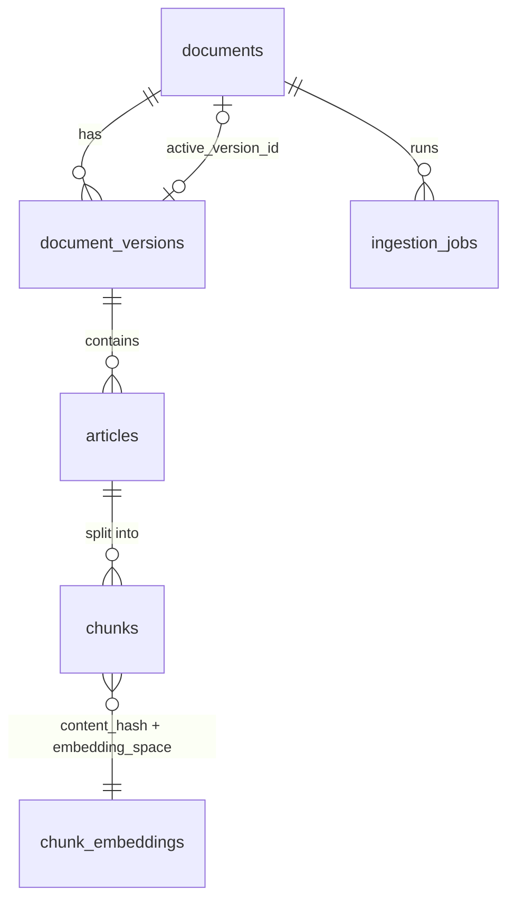

# Architecture

LexUZ RAG is a modular monolith: one Python codebase, several processes.

| Process | Command | Notes |
|---|---|---|
| api | `uvicorn app.api.main:app` | public read API + static frontend |
| worker | `celery -A app.tasks.celery_app worker -Q ingestion --concurrency 1` | ingestion only |
| beat | `celery -A app.tasks.celery_app beat` | weekly source check |
| CLI | `python -m app.cli …` | ingest, approve, reindex, eval |

## Code layout

| Path | Responsibility |
|---|---|
| `app/core/` | settings, structured logging, Redis guards (rate limit, slots, budget) |
| `app/db/`, `app/models/`, `migrations/` | SQLAlchemy 2 models, Alembic schema |
| `app/ingestion/` | sources allow-list, fetcher, Lex.uz parser, publish gate, chunker, pipeline |
| `app/retrieval/` | Uzbek normalization, hybrid search, fusion, context assembly |
| `app/generation/` | prompt, output validation, answer orchestration |
| `app/providers/` | LLM (Gemini, fake) and embedding (fastembed, hashing) adapters |
| `app/api/` | FastAPI app, error catalog |
| `app/tasks/` | Celery app and tasks |
| `app/observability/` | Prometheus metrics |
| `frontend/` | single static page (no build step) |
| `evals/` | benchmark, eval runner, reports |

## Data model

- `documents.active_version_id` is the only pointer default retrieval follows.
- `chunk_embeddings` is keyed by `(content_hash, embedding_space)`. Unchanged
  text is never embedded twice; vectors of two models are never compared.
- `ingestion_jobs` has a partial unique index: one `running` job per document.
- `usage_events` records estimated AI usage (no question text).

## Request path (`POST /api/v1/ask`)

1. nginx rate limit → FastAPI validation (length ≤ 600) → Redis per-IP limit.
2. Hybrid retrieval over active versions (see retrieval-and-citations.md).
3. If nothing relevant: `insufficient_evidence` without calling the LLM.
4. Acquire an LLM slot, check project-wide free-tier caps, reserve worst-case cost, call Gemini with a JSON schema.
5. Validate ids/quotes; at most one repair call; otherwise safe fallback.
6. Build `sources` from database rows (title, label, URL, version, checked time).

The handler only does steps 1 and error mapping; everything else is in
`app/generation/answer.py`.

## Failure behaviour

| Failure | Behaviour |
|---|---|
| Redis down | `/ask` returns 503 `generation_unavailable`; catalog and health keep working |
| Budget exhausted | 503 `budget_exhausted`; no provider call |
| Provider timeout / 429 / 5xx | mapped error code, reservation settled conservatively |
| Lex.uz unreachable / page changed | job fails or version rejected; active version untouched |
| Worker crash mid-ingestion | job left `running` → marked `stale` after 2 h; re-run is idempotent |
