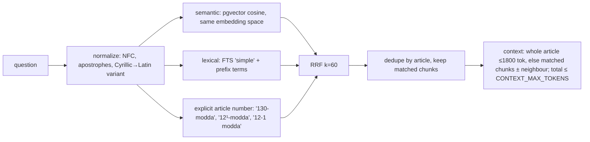

# Retrieval and citations

## Chunking

- Unit = article (`modda`). A short article is one chunk.
- Long articles are split on paragraph boundaries (`CHUNK_MAX_CHARS=1400`);
  an over-long single paragraph is split on sentence boundaries.
- Optional overlap: the previous chunk's last paragraph is repeated if it is
  ≤ 300 chars (`CHUNK_OVERLAP_*`).
- Every chunk's embedding text starts with
  `"<document>. <label>-modda. <title>\n<part › section › chapter>"`.
- Repealed articles (no text + “chiqarilgan” note) are stored but not indexed.
- Token counts are estimates (chars / 4) used for limits only.

## Hybrid search



- Only chunks whose `version_id = documents.active_version_id` and whose
  article is `in_force` are searched. Old versions remain for audit only.
- Uzbek has no stemmer in PostgreSQL. Lexical matching uses the `simple`
  config on normalized text where apostrophes are *removed*
  (`boʻshatish`, `bo'shatish`, `boshatish` → `boshatish`), query stop words are
  dropped and query tokens become prefix terms after a conservative suffix
  strip (`muddati` → `muddat:*`). This is a heuristic; its effect is measured
  in `evals/`.
- For Cyrillic questions a Latin transliteration is searched as well; the
  original question is kept and stored text is never transliterated.
- Reciprocal Rank Fusion: `score(chunk) = Σ 1/(k + rank)` over all lists;
  article score = best chunk score. Scores are not probabilities and are never
  shown to users.
- `RETRIEVAL_TOP_K`, `RETRIEVAL_CANDIDATE_LIMIT`, `CONTEXT_MAX_TOKENS` are configurable.
- No reranker yet; add one only if the dev eval shows ranking errors that fusion cannot fix.

## Embedding spaces and re-indexing

`embedding_space = "<provider>:<model>:<dim>"` is stored with every vector.
To change model:

1. set the new `EMBEDDING_*` values for a CLI run and execute
   `python -m app.cli reindex-embeddings` (old vectors stay);
2. run `python -m app.cli eval retrieval --split dev` with the new settings;
3. switch the API/worker environment and restart;
4. optionally delete old-space rows from `chunk_embeddings`.

Activation refuses a version that is not fully embedded in the current space.

## Answer contract

The model receives sources `S1..Sn` (one per article) and returns JSON:

```json
{"status": "answered | insufficient_evidence | clarification_needed",
 "claims": [{"text": "...", "source_ids": ["S1"], "quotes": [{"source_id": "S1", "quote": "..."}]}],
 "clarifying_question": "", "limitations": []}
```

Backend validation (`app/generation/validate.py`):

| Check | On failure |
|---|---|
| valid JSON, known status | repair |
| every source id was in the context | repair |
| each claim of an answer has ≥ 1 source id and ≥ 1 quote | repair |
| each quote occurs in the cited article's stored text (tolerant to case, whitespace, apostrophe and dash variants) | repair |
| no URLs in model text | repair |
| still invalid after **one** repair | safe fallback: `insufficient_evidence`, no claims, related articles listed |

Citations shown to users are built from database rows only: document title,
article label/title, excerpt sliced from the stored original text, Lex.uz URL
with the real element anchor, version id and “checked at” time. The model
never supplies URLs or article metadata, and the frontend renders links only
for `https://lex.uz/…`.

## What a valid citation does and does not prove

A passing citation proves that the quoted words exist in the cited article of
the active version. It does **not** prove that the claim is a correct reading of
that article (e.g. an exception may be ignored, or a quote may be taken out of
context). Semantic faithfulness is evaluated separately with the manual rubric
in `evals/RUBRIC.md`.

## Prompt injection

- Question and source text are wrapped in tags; `<`/`>` inside them are
  replaced so they cannot close tags; the system prompt tells the model to
  treat both as data.
- The model has no tools (no shell, DB, URL fetch).
- Even if the model follows an injected instruction, the validator rejects
  unknown ids, unsupported quotes and URLs, and the frontend renders text only.
